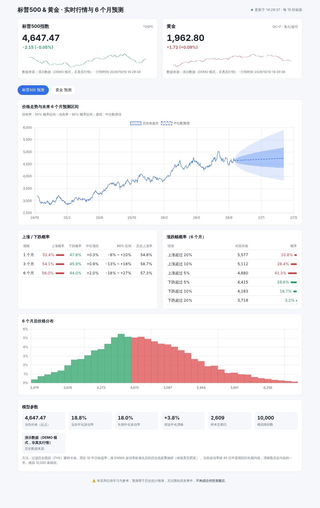

# 标普500 & 黄金 · 实时行情与 6 个月预测

一个零依赖的 Node.js Web 应用：

- **实时行情**：标普500指数（`^GSPC`）与黄金（COMEX 期货 `GC=F`）的最新价格、涨跌幅和当日分时走势，每 15 秒自动刷新
- **6 个月预测**：未来 1 / 3 / 6 个月的价格概率区间（扇形图）、上涨/下跌概率、涨跌超过 ±5% / ±10% / ±20% 的概率，以及 6 个月后价格分布直方图



（截图为演示模式下的随机数据）

## 运行

需要 Node.js 18 及以上，无需 `npm install`。

```bash
npm start          # 真实行情，打开 http://localhost:3000
npm run demo       # 离线演示模式（随机生成数据，无需网络）
npm test           # 运行模型单元测试
```

可以用 `PORT=8080 npm start` 修改端口。

## 数据来源

- 首选 Yahoo Finance 图表接口（分时 + 10 年日线）
- Yahoo 不可用时自动回退到 Stooq 日线数据
- 服务端做了缓存：报价 15 秒，历史数据 1 小时，预测 1 分钟

> Yahoo / Stooq 的免费数据可能有约 15 分钟延迟，且接口并非官方承诺长期可用。

## 预测方法

采用 **过滤历史模拟（Filtered Historical Simulation）蒙特卡洛**：

1. 用近 10 年日收盘价计算对数收益率
2. 用 EWMA（λ = 0.94，RiskMetrics）估计每天的条件波动率
3. 收益率除以当日波动率得到标准化残差 —— 保留了真实市场的肥尾和偏度
4. 模拟 10,000 条 126 个交易日（约 6 个月）的路径：每天从历史残差中随机抽样，乘以模拟的波动率；
   波动率从当前水平按 40 日半衰期回归长期均值
5. 漂移取历史平均收益的一半（收缩），避免把过去的牛市/熊市简单外推

表格中的 **"历史上涨率"** 是过去 10 年里任意同长度窗口中上涨的比例，可作为模型概率的参照基准。

代码在 `src/model.js`，参数（路径数、半衰期、漂移收缩等）都可以在 `forecast()` 的 `opts` 里调整。

## 项目结构

```
src/server.js   HTTP 服务与 API（/api/quote/:key, /api/history/:key, /api/forecast/:key）
src/data.js     行情抓取（Yahoo，失败回退 Stooq）
src/model.js    蒙特卡洛预测模型
src/demo.js     离线演示数据
public/         前端页面（Chart.js）
test/           单元测试
```

## 免责声明

预测基于历史统计规律，只描述"如果未来波动特征与过去相似"时的可能结果，无法预知政策、战争、金融危机等突发事件。
**本项目仅供学习参考，不构成任何投资建议。**
